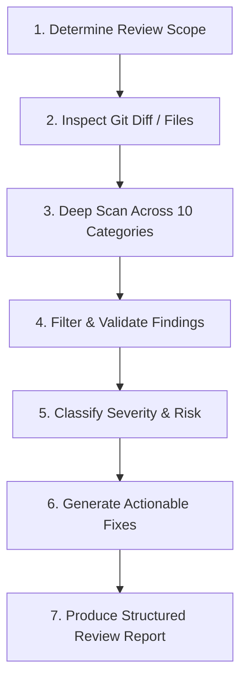

# CodeRabbit-Style Code Review Skill

The **CodeRabbit Review** skill performs thorough, actionable, and mathematically grounded code audits. It systematically evaluates source changes against a 10-point inspection taxonomy, highlighting real vulnerabilities and actionable fixes while eliminating false positives.

---

## 10 Inspection Categories

1. **Bugs & Logical Errors**: Edge cases, null/undefined references, broken math/logic, off-by-one errors.
2. **Security Vulnerabilities**: Injection (SQL, command, template), XSS, CSRF, insecure deserialization, path traversal.
3. **Authentication & Authorization**: Weak JWT validation, missing access controls on endpoints, session hijacking, improper role checks.
4. **Input Validation & Error Handling**: Missing request payload schemas, unhandled exceptions, swallowed tracebacks, broad `except Exception:`.
5. **API Key & Secret Exposure**: Hardcoded tokens, credentials in comments/logs, unsafe environment leaks.
6. **Database Access & Data Integrity**: Transaction leaks, unindexed queries, session/connection leaks, cascade delete side-effects.
7. **Performance & Scalability**: N+1 queries, unmemoized expensive computations, blocking I/O in async routines, memory leaks.
8. **Race Conditions & Asynchronous Behavior**: Missing locks/atomic transactions, async/await misordering, unhandled Promise rejections.
9. **Regression Risks & Missing Tests**: Untested edge cases, altered public interfaces breaking callers, missing test coverage.
10. **Maintainability & Complexity**: Excessive cyclomatic complexity, dead code, duplicated logic, violate DRY/SOLID principles.

---

## Standardized Finding Format

Every finding MUST strictly follow this format:

```markdown
### [CRITICAL | HIGH | MEDIUM | LOW] Finding Title
- **Classification**: [Confirmed Vulnerability | Potential Risk | Code Smell]
- **Location**: [`<relative/file/path>:<line_number>`](file:///<absolute/file/path>#L<line_number>)
- **Problem**: Concise explanation of the defect or vulnerability.
- **Scenario**: Realistic walkthrough of how and when this failure manifests in production or edge cases.
- **Recommended Fix**:
  ```diff
  - old_code()
  + new_hardened_code()
  ```
```

---

## Review Execution Procedure



### Step 1: Establish Review Scope
- If review targets a git branch or commit:
  - Run `git diff main...HEAD` or `git diff HEAD~1` or `git status`.
- If review targets specific files/directories:
  - Read files with `view_file`.
- Check related configuration files (`SECURITY_AUDIT.md`, `package.json`, `pyproject.toml`) for existing security baselines.

### Step 2: System Examination
- Consult the [Review Checklist](./references/review-checklist.md) for detailed verification criteria across the 10 categories.
- Distinguish between **Confirmed Vulnerabilities** (reproducible flaws) and **Potential Risks** (defense-in-depth suggestions).
- **Zero Hallucination Rule**: Never invent vulnerabilities, hypothetical CVEs, or false positives. Verify findings against actual code.

### Step 3: Produce Code Review Report
Deliver a structured review organized as:
1. **Executive Summary**: Overview of changes reviewed, overall code health score, and risk breakdown table (Count of Critical, High, Medium, Low).
2. **Critical & High Priority Findings**: Immediate blockers with full scenarios and code fixes.
3. **Medium & Low Priority Findings**: Optimization, defensive checks, and maintainability suggestions.
4. **Positive Highlights**: Commend well-implemented patterns, clean architecture, or solid test coverage.
5. **Review Verdict**: `APPROVE`, `REQUEST CHANGES`, or `COMMENT`.
