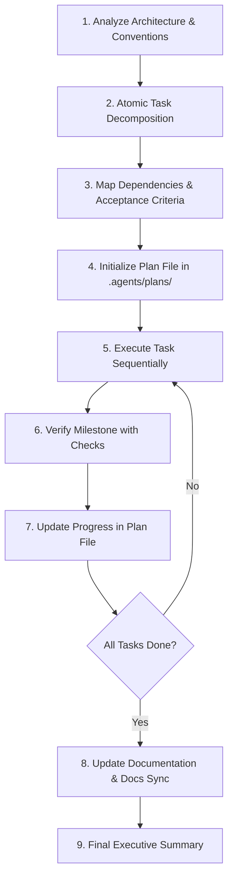

# GSD (Get Shit Done) — Structured Project Execution Skill

The **GSD Workflow** delivers structured, disciplined, and production-grade software engineering. It prioritizes atomic progress, architectural consistency, and verified milestones over ad-hoc edits.

---

## Core Principles

1. **Architecture & Convention First**: Understand existing patterns before writing a single line of code.
2. **Atomic Deconstruction**: Break features down into small, isolated, and verifiable tasks.
3. **Execution Transparency**: Track task status in a persistent plan file within `.agents/plans/`.
4. **Verified Milestones**: Validate each milestone with automated checks (tests, builds, type checking).
5. **Minimalist & Maintainable**: Prefer minimal surgical edits over wide rewrites.

---

## 9-Step Execution Procedure

### Step 1: Architectural & Convention Analysis
- Inspect project structure, dependency trees, and technology stack:
  - Backend: FastAPI, SQLModel/PostgreSQL, LangChain, Pydantic v2.
  - Frontend: React 18, TypeScript, TailwindCSS, Vite.
- Identify existing code conventions, folder structures, and existing utility helpers.

### Step 2: Atomic Task Decomposition
- Deconstruct the user's high-level goal into self-contained tasks.
- Keep each task small enough to be completed and verified within a single focused step.

### Step 3: Dependencies & Acceptance Criteria
- For each task, define:
  - **Prerequisites**: Tasks that must be completed prior to starting.
  - **Target Files**: Explicit files to create or modify.
  - **Verification Method**: Specific test command, lint check, or build to run.
  - **Acceptance Criteria**: Concrete condition for marking the task complete.

### Step 4: Plan File Initialization
- Create a dedicated tracking file in `.agents/plans/<feature-slug>-plan.md` using the [Task Plan Template](./resources/task-plan-template.md).
- Status legend:
  - `[ ]` Pending
  - `[/]` In Progress
  - `[x]` Completed & Verified
  - `[-]` Blocked / Deferred

### Step 5: Sequential Implementation
- Work through tasks in strict dependency order.
- Follow the principle of least disturbance: do not refactor working code unless directly required.

### Step 6: Milestone Verification
- Immediately after implementing a task, run its verification command:
  - Backend unit tests: `python run_tests.py` or targeted test.
  - Frontend type checks & build: `npm run build` in `frontend/`.
- Do not proceed to the next task if the current task's verification fails.

### Step 7: Progress Tracking
- Update the `.agents/plans/<feature-slug>-plan.md` file using `replace_file_content`.
- Mark the task `[x]` and add brief execution notes or command outputs.

### Step 8: Documentation Sync
- If APIs, configurations, or interfaces changed:
  - Update relevant `.env.example`, schemas, or docstrings.
  - Update user-facing documentation if applicable (e.g. `README.md`).

### Step 9: Final Executive Summary
Present a comprehensive completion summary:
- **Completed Tasks**: Detailed list of tasks executed and verified.
- **Verification Evidence**: Commands run and clean test results.
- **Modified & Created Files**: Clickable links (`file://...`).
- **Plan File Reference**: Link to the completed plan file in `.agents/plans/`.
