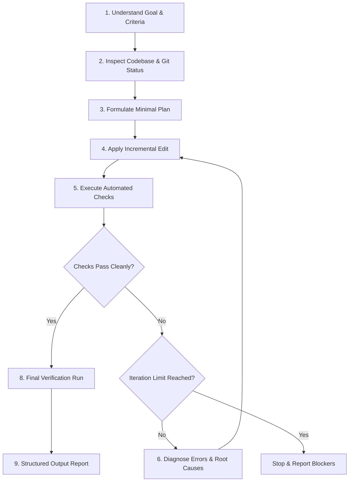

# Ralph Loop — Iterative Development Skill

The **Ralph Loop** is a rigorous, test-driven agentic workflow designed for autonomous, progressive problem solving. It enforces continuous feedback by coupling incremental code edits directly with concrete automated test and build commands.

---

## Core Operational Constraints

> [!CAUTION]
> **Safety Invariants**:
> - **Zero Fabrication**: Never claim tests or builds passed unless executed in the session with an exit code of `0`.
> - **Data & Secret Protection**: Never touch or truncate persistent databases (`*.db`, `auth_store.json`), user uploads (`uploads/`), or environment secrets (`.env`).
> - **Infrastructure Safeguard**: Do NOT modify production deployment assets (`aws/deploy.sh`, `docker-compose.prod.yml`, `k8s/`) or trigger remote deployments.
> - **Git Discipline**: Always run `git status` before touching files to ensure uncommitted work is preserved.
> - **Iteration Cap**: Stop after reaching the configured iteration limit (default: **5 iterations**) if criteria are not satisfied.

---

## Iterative Execution Workflow

### Step 1: Goal Definition & Acceptance Criteria
1. Clarify the target feature or bug fix.
2. Define explicit, measurable **Acceptance Criteria (AC)** (e.g., target test suite passes, zero TypeScript errors, specific HTTP status code returned).
3. Set the iteration limit (default: 5; allow user to override with e.g. `iterations: N`).

### Step 2: Codebase Inspection
1. Run `git status` via `run_command` to inspect dirty files.
2. View existing code and tests in target areas using `view_file` and `grep_search`.
3. Locate active test commands relevant to the task:
   - **Backend Tests**: `python run_tests.py` or `python -m unittest backend/tests/<test_name>.py`
   - **Frontend Build & Types**: `npm run build` (within `frontend/`)
   - **Full CI Simulation**: See [iteration-protocol.md](./references/iteration-protocol.md)

### Step 3: Minimal Implementation Plan
1. Detail the smallest sufficient set of changes needed.
2. Avoid broad refactorings or rewriting entire files.
3. Identify which files will be modified and which tests will validate the change.

### Step 4: Incremental Implementation
1. Apply focused modifications using `replace_file_content` or `multi_replace_file_content`.
2. Do not delete unrelated comments, docstrings, or existing features.

### Step 5: Execute Relevant Tests & Builds
1. Execute the targeted automated checks immediately using `run_command`.
2. Capture the exact command line, stdout, stderr, and return code.
3. If dependencies or environment variables are required, use standard test flags (e.g. `TESTING=1`).

### Step 6: Diagnose & Fix Failures
1. If any test or build fails (exit code != 0), analyze the exact stack trace and line number.
2. Formulate a targeted fix addressing the root cause.
3. If an unexpected blocker arises (e.g., missing third-party credential or breaking architectural requirement), stop and alert the user.

### Step 7: Iterate (Loop Controller)
- Increment iteration counter: `current_iteration += 1`.
- If `current_iteration <= MAX_ITERATIONS`: Repeat from **Step 4**.
- If `current_iteration > MAX_ITERATIONS`: Cease modifications, explain what failed, and prompt the user with diagnostic logs.

### Step 8: Final Verification
1. Run the full relevant test suite (not just isolated single unit tests) to catch regressions.
2. Verify that `git status` reflects only intended file modifications.

### Step 9: Structured Completion Report
Deliver a clear summary with:
- **Status**: Successful / Blocked / Cap Reached
- **Modified Files**: Clickable `file://` links
- **Executed Commands & Results**: Exact commands run and pass/fail status
- **Resolved Criteria**: Itemized checklist of met acceptance criteria
- **Remaining / Unresolved Issues**: Any follow-up items
